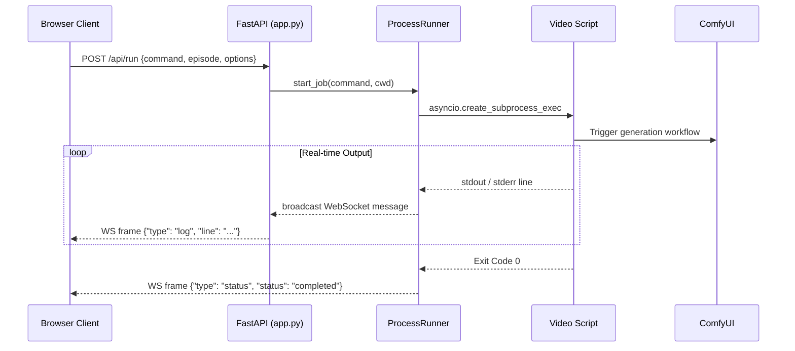

# Architecture & Design

KCT Studio is structured into modular Python packages within the `core/` package, orchestrated by an ASGI FastAPI application (`app.py`), and supervised by a desktop System Tray process (`tray_app.py`).

---

## 1. Directory Layout

```text
AI-Content-Generation-Pipeline/
├── app.py                      # Main FastAPI server & HTTP/WS routing
├── tray_app.py                 # Windows System Tray controller & boot launcher
├── config.json                 # Studio projects, server, and social settings
├── requirements.txt            # Python dependencies
├── run.bat                     # Foreground launch script
├── start_tray.bat              # Silent System Tray launcher
├── start_tray.vbs              # Windowless VBScript launcher
├── install_startup.bat         # Boot auto-start installer (Registry HKCU)
├── uninstall_startup.bat       # Boot auto-start remover
├── install_certificate.bat     # Windows Root Certificate trust installer
├── trust_cert.ps1              # PowerShell certificate trust helper
│
├── core/                       # Core modules & business logic
│   ├── __init__.py
│   ├── asset_manager.py        # Media discovery, ffprobe metadata, thumbnail caching
│   ├── cert_manager.py         # Self-signed SAN SSL certificate creation & trust
│   ├── config.py               # JSON configuration manager with safe fallbacks
│   ├── gpu_monitor.py          # NVIDIA GPU telemetry & ComfyUI health check
│   ├── process_runner.py       # Asynchronous CLI subprocess execution & log broadcasting
│   ├── project_scanner.py      # Multi-project structure scanner (episodes, chapters)
│   └── social_dispatcher.py    # Multi-platform social media dispatch & webhook publisher
│
├── static/                     # Web dashboard assets
│   ├── index.html              # Single-page studio interface
│   ├── css/
│   │   └── styles.css          # Custom styling & scrollbar layout
│   └── js/
│       └── app.js              # State management, API clients, WebSocket listener
│
├── data/                       # Local data persistence
│   ├── media_catalog.json      # Persistent catalog of generated videos & social flags
│   └── thumbnails/             # Cached video poster frames (.jpg)
│
├── certs/                      # Generated SSL/TLS certificates (.pem, .crt)
├── logs/                       # Server & tray runtime logs (.log)
└── docs/                       # Technical documentation
```

---

## 2. Core Modules Breakdown

### `core.config.ConfigManager`
- Loads `config.json` at startup.
- Manages active project paths, ComfyUI endpoints, server host/port, SSL toggles, and social media provider flags.
- Exposes thread-safe retrieval and persistence methods.

### `core.project_scanner.ProjectScanner`
- Recursively scans project directories (`manhwa`, `documentary`, `reels`).
- Identifies episodes, chapters, parts, and sections from folder naming conventions (`reel76_*`, `Chapter_1`, etc.).
- Formats available CLI commands (e.g. `generate_reel`, `generate_chapter`, `combine_chapters`).

### `core.asset_manager.AssetManager`
- Scans project output directories for generated MP4, MOV, and WebM videos.
- Uses `ffprobe` (with `CREATE_NO_WINDOW`) to extract video duration, dimensions, codecs, and resolutions without flashing command prompts.
- Uses `ffmpeg` (with `CREATE_NO_WINDOW`) to capture poster thumbnails and cache them under `data/thumbnails/`.
- Maintains persistent metadata status in `data/media_catalog.json` (title, duration, social media post flags).

### `core.process_runner.ProcessRunner`
- Executes long-running AI video generation scripts as asynchronous background subprocesses via `asyncio.create_subprocess_exec`.
- Streams stdout and stderr line-by-line in real time to connected browser clients over WebSocket (`/ws/logs`).
- Supports non-blocking process termination (`stop()`) with recursive process tree killing via `psutil` and fallback `taskkill`.
- Maintains an in-memory ring buffer of the last 2,500 log lines to immediately replay history to newly connecting clients.

### `core.gpu_monitor`
- Queries `nvidia-smi` to extract GPU model name, memory usage (total/used/free), temperature, and GPU load.
- Uses `CREATE_NO_WINDOW` to avoid flashing conhost/cmd shells every polling cycle.
- Verifies live connectivity with ComfyUI (`http://127.0.0.1:8188/system_stats`).

### `core.cert_manager.CertManager`
- Generates 2048-bit RSA self-signed SSL/TLS certificates with Subject Alternative Names (SAN) for `localhost`, `127.0.0.1`, and the local LAN IPv4 address.
- Provides automatic Windows Certificate Store trust injection into `Cert:\CurrentUser\Root`.

### `core.social_dispatcher.SocialDispatcher`
- Manages publication state toggles across YouTube, Facebook, TikTok, X, and Instagram.
- Persists post states per video episode in `data/media_catalog.json`.
- Dispatches webhook payloads when videos are approved or marked as posted.

---

## 3. Real-Time Data Flow


