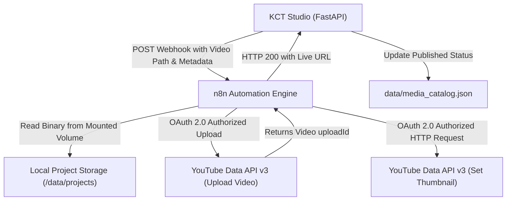

# Google OAuth 2.0 & YouTube Publishing Setup Guide

This guide provides step-by-step instructions for configuring Google Cloud OAuth 2.0 credentials and integrating them with **n8n** and **KCT Studio** for automated YouTube video and thumbnail uploads.

---

## 1. Overview & Architecture



---

## 2. Google Cloud Console Setup

### Step 1: Create or Select a Google Cloud Project
1. Open the [Google Cloud Console](https://console.cloud.google.com/).
2. Click the project dropdown at the top navigation bar and click **New Project**.
3. Set **Project Name**: `kct-studio-uploader` (or your preferred name).
4. Click **Create** and ensure the project is selected.

---

### Step 2: Enable the YouTube Data API v3
1. In the left navigation menu, go to **APIs & Services** > **Library**.
2. In the search box, type `YouTube Data API v3`.
3. Click on **YouTube Data API v3** from the search results.
4. Click **Enable**.

---

### Step 3: Configure the OAuth Consent Screen
1. In the left navigation menu, go to **APIs & Services** > **OAuth consent screen**.
2. Select **External** as the User Type, then click **Create**.
3. **App Information**:
   - **App name**: `KCT Studio Uploader`
   - **User support email**: Select your Google email address.
   - **Developer contact information**: Enter your email address.
   - Click **Save and Continue**.
4. **Scopes**:
   - Click **Add or Remove Scopes**.
   - Search for and select the following scopes:
     - `https://www.googleapis.com/auth/youtube.upload` *(Upload YouTube videos)*
     - `https://www.googleapis.com/auth/youtube` *(Manage YouTube account & custom thumbnails)*
     - `https://www.googleapis.com/auth/youtube.force-ssl` *(Manage YouTube account securely)*
   - Click **Update** and then **Save and Continue**.
5. **Test Users (CRITICAL)**:
   - While the publishing status is **Testing**, only authorized test users can authenticate.
   - Click **+ Add Users**.
   - Enter the exact Google email address associated with the YouTube channel where videos will be uploaded.
   - Click **Add**, then click **Save and Continue**.
   - Review summary and click **Back to Dashboard**.

> [!IMPORTANT]
> If the uploading Google account is not added as a **Test User**, any OAuth login attempt will fail immediately with `403: access_denied` ("This app is blocked" or "User not listed").

---

### Step 4: Create OAuth 2.0 Credentials
1. In the left navigation menu, go to **APIs & Services** > **Credentials**.
2. Click **+ Create Credentials** at the top, then choose **OAuth client ID**.
3. Set **Application type**: `Web application`.
4. Set **Name**: `n8n YouTube OAuth2 Client`.
5. Under **Authorized redirect URIs**, click **+ Add URI** and enter:
   ```text
   http://localhost:5678/rest/oauth2-credential/callback
   ```
   *(Note: If n8n runs behind a reverse proxy or domain, use your domain's callback URL, e.g. `https://n8n.yourdomain.com/rest/oauth2-credential/callback`).*
6. Click **Create**.
7. A dialog will display:
   - **Client ID** (e.g. `YOUR_CLIENT_ID.apps.googleusercontent.com`)
   - **Client Secret** (e.g. `GOCSPX-YOUR_CLIENT_SECRET`)
8. Click **Download JSON** (saved as `docs/client_secret_<client_id>.json`) and copy both values into `docs/Google_ClientID_ClientSecret.txt`.

---

## 3. n8n Credential Configuration

### Step 1: Open n8n & Add Credential
1. Open n8n in your browser at `http://localhost:5678/`.
2. In the left sidebar, click **Credentials**.
3. Click **Add Credential** in the top right.
4. Search for `YouTube OAuth2 API` and select it.

---

### Step 2: Configure Custom OAuth Credentials
1. In the credential setup window:
   - **Credential Name**: `YouTube account`
   - Toggle **Connect using custom OAuth credentials** to `ON`.
2. Paste the credentials:
   - **Client ID**: Paste your Google Client ID.
   - **Client Secret**: Paste your Google Client Secret.
3. Verify that the **OAuth Redirect URL** displayed in n8n matches:
   ```text
   http://localhost:5678/rest/oauth2-credential/callback
   ```

---

### Step 3: Authenticate with Google
1. Click the **Sign in with Google** button in the credential modal.
2. A new browser window will open Google's account selection:
   - Select the Google account you added as a **Test User** in Step 3 of the Google Cloud setup.
3. If Google shows the **"Google hasn't verified this app"** warning:
   - Click **Advanced** (small link in bottom left).
   - Click **Go to KCT Studio Uploader (unsafe)**.
4. Check all permission checkboxes requested (Upload videos, manage YouTube account) and click **Continue**.
5. Google will redirect back to n8n.
6. The modal in n8n will update to show **"Connected"** (or a green checkmark). Click **Save**.

---

## 4. Workflow Implementation

The credentials are wired into the automation workflow defined in `docs/n8n_social_posting_workflow.json`:

### 1. YouTube Video Upload Node (`n8n-nodes-base.youTube`)
- **Credential**: `YouTube account` (`youTubeOAuth2Api`)
- **Resource**: `video`
- **Operation**: `upload`
- **Binary Property**: `video_data` (read directly from `/data/projects/...`)
- **Title**: `={{ $node["KCT Webhook Trigger"].json.body.content.title }}`
- **Description**: `={{ $node["KCT Webhook Trigger"].json.body.content.youtube_description || $node["KCT Webhook Trigger"].json.body.content.description }}`
- **Tags**: `={{ $node["KCT Webhook Trigger"].json.body.content.tags ? $node["KCT Webhook Trigger"].json.body.content.tags.join(',') : '' }}`
- **Privacy Status**: `={{ $node["KCT Webhook Trigger"].json.body.platform_configs?.youtube?.privacy_status || "public" }}`

### 2. Upload YouTube Thumbnail Node (`n8n-nodes-base.httpRequest`)
- **Authentication**: `predefinedCredentialType`
- **Node Credential Type**: `youTubeOAuth2Api` (`YouTube account`)
- **Method**: `POST`
- **URL**:
  ```text
  =https://www.googleapis.com/upload/youtube/v3/thumbnails/set?videoId={{ $node["YouTube Video Upload"].json.uploadId || $node["YouTube Video Upload"].json.id }}&uploadType=media
  ```
- **Send Body**: `true`
- **Content Type**: `binaryData`
- **Input Data Field Name**: `thumbnail_data`
- **Continue on Fail**: `true`

---

## 5. End-to-End Testing

1. **Verify Webhook Settings in KCT Studio**:
   - Go to KCT Studio > **Social Automation**.
   - Ensure **Automation Webhook URL** is set to:
     ```text
     http://localhost:5678/webhook/kct-social-publish
     ```
   - Click **Test Webhook** to confirm connectivity.
2. **Execute Video Publishing**:
   - Select any rendered episode in the Studio dashboard.
   - Click **Publish to Social** (or **Approve & Post**).
   - n8n will process the video, upload it to YouTube, attach the custom thumbnail, and return the live URL:
     ```text
     https://youtu.be/{videoId}
     ```
   - KCT Studio will automatically mark the episode with the YouTube badge and store the link in `data/media_catalog.json`.

---

## 6. Troubleshooting & Common Pitfalls

| Issue | Cause | Solution |
| :--- | :--- | :--- |
| **`403: access_denied` on login** | Uploading user is not listed under Test Users | Go to **OAuth consent screen** > **Test users** in Google Cloud Console and add the user's email. |
| **`redirect_uri_mismatch`** | Redirect URI in Google Console does not match n8n | Ensure `http://localhost:5678/rest/oauth2-credential/callback` is added under **Authorized redirect URIs**. |
| **OAuth token expired after 7 days** | Google Testing apps expire refresh tokens after 7 days | Re-connect in n8n Credential settings, or move App Publishing Status to "Production" in Google Cloud Console. |
| **YouTube Upload Quota Exceeded (403 quotaExceeded)** | Default daily quota is 10,000 units (upload ~1,600 units each) | Each video upload uses ~1,600 units (approx. 6 videos/day on free tier). Request a quota increase in Google Cloud Console if higher volume is needed. |
| **Thumbnail upload 403 Forbidden** | Channel phone verification missing | Custom thumbnails require a phone-verified YouTube channel in YouTube Studio settings. |
