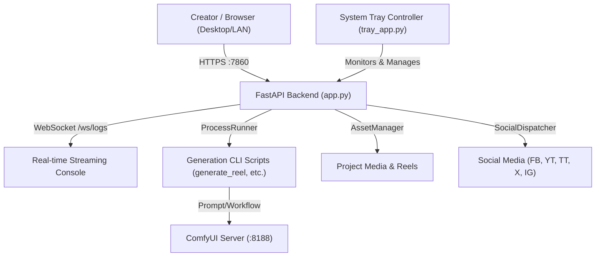

# KCT Studio Documentation

Welcome to the official technical documentation for **KCT Studio (v2.0)** — an automated, multi-project AI video generation pipeline and management dashboard built with FastAPI, WebSockets, ComfyUI, and a Windows System Tray background controller.

---

## Documentation Directory

| Document | Description |
|---|---|
| [**Architecture Overview**](architecture.md) | High-level system design, multi-project scanner, WebSocket log streaming, and sub-systems. |
| [**Getting Started**](getting_started.md) | Prerequisites, environment installation, SSL certificate setup, and running the studio. |
| [**System Tray & Boot Auto-Start**](system_tray_and_startup.md) | Windows System Tray integration, `HKCU` registry boot auto-start, silent execution, and mutex handling. |
| [**API Reference**](api_reference.md) | Complete documentation of FastAPI REST endpoints, WebSocket log streaming, and payloads. |
| [**Frontend Guide**](frontend_guide.md) | Visual walkthrough of the UI: project switcher, episode list, command builder, social media toggles, and console. |
| [**Troubleshooting & FAQ**](troubleshooting.md) | Solutions for common Windows issues, SSL certificate trust, `CREATE_NO_WINDOW`, and port resolution. |

---

## High-Level System Overview

---

## Core Technologies

- **Backend**: Python 3.10+, FastAPI, Uvicorn (ASGI), WebSockets
- **OS Integration**: Windows Win32 API (`pystray`, `psutil`, `winreg`, `ctypes`)
- **Video & AI Tooling**: ComfyUI, Torch, ffmpeg, ffprobe, NVIDIA CUDA Driver (`nvidia-smi`)
- **Frontend**: Vanilla JavaScript (ES6+), Tailwind CSS, Lucide Icons, AnsiUp (terminal emulation)
