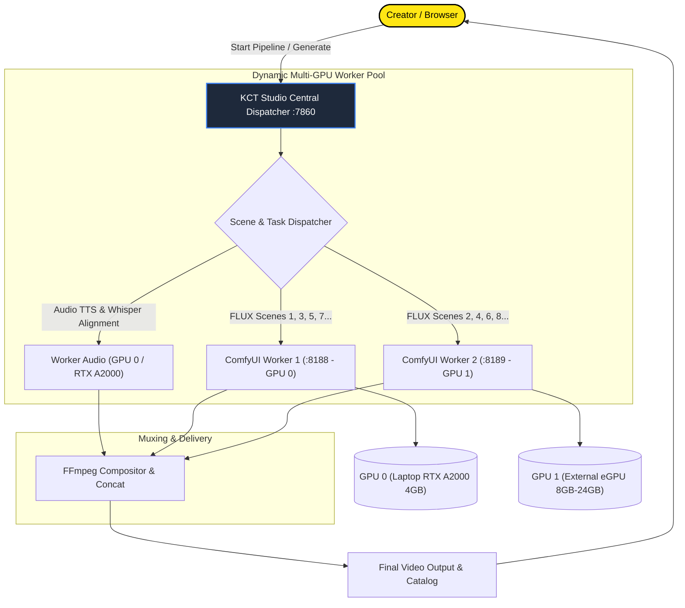

# Multi-GPU & Distributed Worker Architecture Roadmap

This document outlines the architectural roadmap for expanding **KCT Studio** into a Multi-GPU and distributed rendering system. It details how connecting a secondary GPU (e.g. an eGPU over USB4 / Thunderbolt / OCuLink or a secondary PCIe card) will automatically scale ComfyUI and video rendering capacity.

---

## 1. Vision & Architecture Overview

Modern AI content production demands significant compute during image synthesis (FLUX/SDXL) and vocal synthesis (VibeVoice/Whisper). Rather than running disjointed instances in separate browser tabs, KCT Studio follows the **Unified Control Plane + Distributed Worker Pool** architecture (used by professional render farms and distributed AI clusters).

---

## 2. Comparison: Monolithic Tabs vs. Clustered Worker Pool

| Dimension | Multi-Tab Approach (Option A) | Clustered Worker Pool (Option B) |
|---|---|---|
| **Control** | Juggling 2+ browser tabs on different ports (`:7860`, `:7861`). | Single unified dashboard on `:7860`. |
| **GPU Utilization** | **Unbalanced**: If one tab finishes early, its GPU idles while the other is maxed out. | **Optimal**: Shared job queue. The moment any GPU finishes a scene, it immediately pulls the next available scene. |
| **Asymmetric Hardware** | Difficult to balance (e.g. 4GB laptop GPU vs 12GB eGPU). | **Intelligent Routing**: Lightweight tasks (TTS/Whisper) route to smaller GPU; heavy FLUX scenes route to larger GPU. |
| **Render Speed** | Manual batch splitting required. | **Automatic 2x speedup** on scene generation. |
| **Network Scale** | Limited to local host. | Extensible across LAN (remote rendering nodes). |

---

## 3. Implementation Roadmap

### Phase 1: Hardware Isolation & CLI Port Overrides (Immediate Foundation)
Allows launching independent studio instances on distinct ports and GPU bindings if manual separation is desired.

1. **CLI Parameter Arguments in `app.py`**:
   - `--port <int>` (Default: `7860`)
   - `--gpu <int>` (Default: `0`)
   - `--comfy-port <int>` (Default: `8188`)
2. **Environment Variable Pinning in `core/process_runner.py`**:
   - Automatically inject `CUDA_VISIBLE_DEVICES = str(assigned_gpu)` into the spawned script execution environment.
3. **ComfyUI Auto-Start Mapping**:
   - Pass `--cuda-device <index> --port <port>` when triggering background ComfyUI instances.

### Phase 2: Dynamic Multi-GPU Worker Pool (Unified Cluster)
Enables a single KCT Studio instance to manage multiple GPUs and ComfyUI instances simultaneously.

1. **Hardware Telemetry Enhancement**:
   - Query `nvidia-smi` to enumerate all available GPUs.
   - Display distinct telemetry gauges in the UI header for each connected GPU (VRAM, temp, utilization).
2. **ComfyUI Multi-Instance Manager**:
   - Auto-detect GPU count and spawn separate ComfyUI daemon instances:
     - Worker 0: Port `8188`, `--cuda-device 0`
     - Worker 1: Port `8189`, `--cuda-device 1`
   - Monitor health and status for all active workers (`ComfyUI-0: Online`, `ComfyUI-1: Busy`).
3. **Parallel Scene Generation Dispatcher**:
   - Update scene generation logic in `generate_reel.py`, `generate_image.py`, and `generate_video.py`.
   - Instead of generating scenes sequentially (1, 2, 3... 12), dispatch scene generation jobs asynchronously across available ComfyUI worker URLs (`:8188`, `:8189`).
   - Collect finished images upon completion and proceed to FFmpeg composition.

---

## 4. Hardware Reference & Connection Notes

- **Laptop Internal GPU**: NVIDIA RTX A2000 Laptop GPU (4096 MB VRAM). Best suited for VibeVoice neural speech synthesis, Whisper alignment, and smaller ComfyUI workflows.
- **Secondary GPU Options**:
  - eGPU Enclosure (Thunderbolt 3/4, USB4, or OCuLink) housing an RTX 3060 (12GB), RTX 4070 (12GB), or RTX 4090 (24GB).
  - High VRAM enables higher resolution FLUX models (dev/schnell), larger batches, and FP16/BF16 precision without disk offloading.

---

*Saved to documentation repository for future implementation.*
