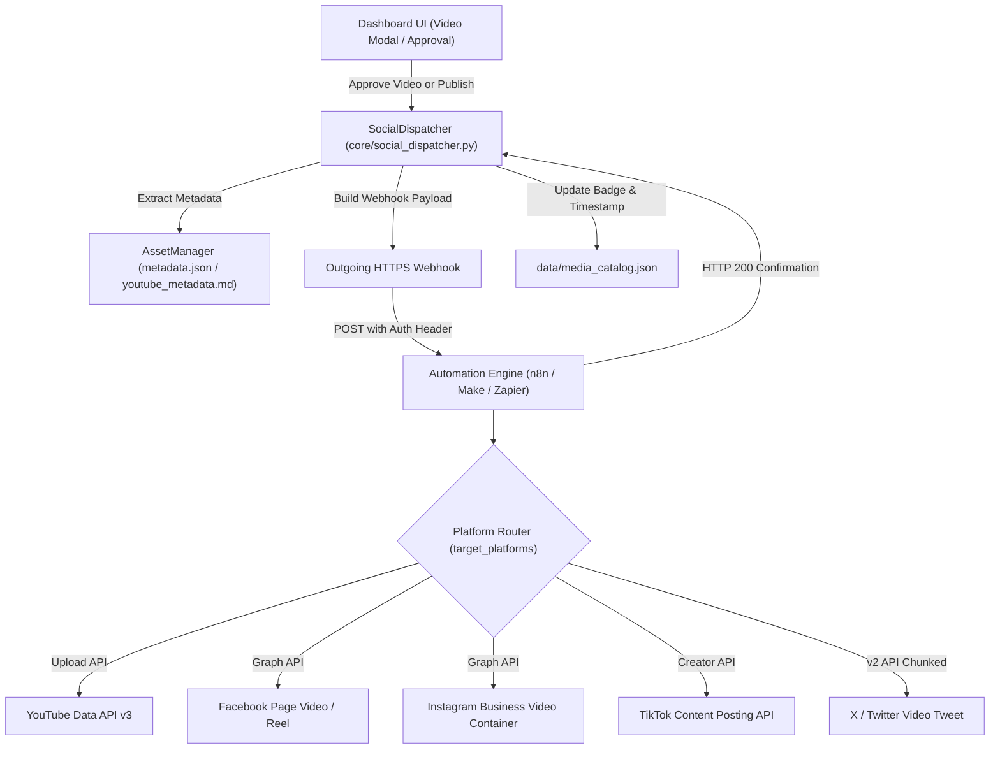

# Social Media Automation Guide (n8n, Make, Zapier & Multi-Platform)

KCT Studio features an automated social media distribution engine designed to publish AI-generated videos, reels, and stories directly across all 5 major platforms:
- **YouTube** (Shorts & Standard Videos)
- **Facebook** (Page Videos & Reels)
- **Instagram** (Reels & Feed Videos)
- **TikTok** (Shorts & Video Posts)
- **X** (Twitter Video Tweets)

---

## 1. Architecture & Dispatch Flow

Instead of requiring individual, brittle browser logins or complex enterprise API rate limits inside the core Python runtime, KCT Studio uses an event-driven **Webhook Publishing Architecture**:



---

## 2. Webhook Payload Specification

When a video is approved (or manually published), KCT Studio sends an HTTP `POST` to your configured `webhook_url`. If `webhook_auth_header` is defined, it is included in the request headers (e.g. `Authorization: Bearer <your-secret-token>`).

### Example JSON Payload:

```json
{
  "event": "video_approved_and_publish",
  "timestamp": 1726915200.0,
  "timestamp_iso": "2026-09-22T04:05:00Z",
  "dry_run": false,
  "project": {
    "name": "Manhwa Cinema Lab",
    "type": "manhwa",
    "path": "E:\\Projects\\Manhwa Cinema Lab"
  },
  "video": {
    "filename": "chapter_1_full.mp4",
    "rel_path": "chapter_1/slideshow/chapter_1_full.mp4",
    "abs_path": "E:\\Projects\\Manhwa Cinema Lab\\chapter_1\\slideshow\\chapter_1_full.mp4",
    "size_bytes": 104857600,
    "size_mb": 100.0,
    "duration": "12:30",
    "duration_sec": 750.0,
    "resolution": "1920x1080",
    "aspect_ratio": "16:9",
    "is_short_or_reel": false,
    "local_url": "https://127.0.0.1:7860/api/video/chapter_1%2Fslideshow%2Fchapter_1_full.mp4"
  },
  "content": {
    "title": "Solo Leveling Episode 1 Recap",
    "description": "Full story recap of episode 1...",
    "tags": ["manhwa", "anime", "recap", "sololeveling"],
    "hashtags_string": "#manhwa #anime #recap #sololeveling",
    "caption": "Solo Leveling Episode 1 Recap #manhwa #anime #recap #sololeveling"
  },
  "target_platforms": [
    "youtube",
    "facebook",
    "instagram",
    "tiktok",
    "x"
  ],
  "platform_configs": {
    "youtube": { "enabled": true, "privacy_status": "unlisted" },
    "facebook": { "enabled": true },
    "instagram": { "enabled": true },
    "tiktok": { "enabled": true },
    "x": { "enabled": true }
  }
}
```

### Key Payload Attributes:
- **`video.abs_path`**: Absolute path on the host system. If your n8n runner is hosted locally or shares a drive mount, it can read the binary directly from disk with zero network transfer overhead.
- **`video.local_url`**: Accessible HTTP endpoint within KCT Studio. Can be proxied via Cloudflare Tunnel or Tailscale if using cloud n8n/Make.
- **`video.is_short_or_reel`**: Automatically calculated (`true` if aspect ratio is vertical `9:16` or duration is under 60 seconds). Workflows use this to route between YouTube Shorts vs Long-form videos.
- **`content.hashtags_string` & `caption`**: Pre-formatted for instant posting to character-constrained feeds like X or TikTok.

---

## 3. Setting Up n8n (Recommended)

n8n is a free, self-hostable workflow automation tool that provides nodes for YouTube, Facebook, Twitter, and custom HTTP requests.

### Option A: Running n8n Locally with Docker (Recommended)
Running n8n locally gives it direct access to your local video storage drives (`E:\`, `C:\`):

```powershell
docker run -d `
  --name n8n `
  -p 5678:5678 `
  -v n8n_data:/home/node/.n8n `
  -v "E:\Projects:/data/projects:ro" `
  -e N8N_DEFAULT_BINARY_DATA_MODE=filesystem `
  n8nio/n8n
```

### Option B: Running n8n via npm
```powershell
npm install n8n -g
n8n start
```

---

## 4. Importing the Workflow Blueprint

KCT Studio provides a complete, pre-configured workflow template located in:
[`docs/n8n_social_posting_workflow.json`](n8n_social_posting_workflow.json)

### To Import:
1. Open n8n (`http://localhost:5678`).
2. Go to **Workflows** -> click **Add Workflow**.
3. Click the **three dots menu (⋮)** in the top right -> select **Import from File**.
4. Choose `docs/n8n_social_posting_workflow.json` (or copy the JSON and press `Ctrl+V` on the canvas).
5. The workflow connects:
   - **Webhook Trigger**: Listens on `POST /webhook/kct-social-publish`.
   - **Auth Validation**: Checks `headers.authorization` against your secret.
   - **File Reader**: Reads binary media using `video.abs_path`.
   - **Platform Switcher**: Checks `target_platforms` array and dispatches concurrently to:
     - **YouTube Node**: Posts with `title`, `description`, and `tags`.
     - **Facebook Page Node**: Posts to Meta Graph API.
     - **Instagram Graph API**: Creates video media container and initiates publishing.
     - **TikTok Node**: Calls TikTok Content Creator endpoint.
     - **X Node**: Calls Twitter v2 API media upload.
   - **Response Node**: Replies `200 OK` back to KCT Studio.

---

## 5. Platform API Setup & Credentials

### 1. YouTube Data API v3
> [!TIP]
> For the complete step-by-step walkthrough covering Google Cloud Console, Scopes, Test Users, and n8n custom credentials, see: [**Google OAuth & YouTube Setup Guide**](google_oauth_setup_guide.md).

- **Google Cloud Console**: Enable **YouTube Data API v3**.
- **OAuth 2.0 Credentials**: Create an OAuth Client ID (type: Web Application or Desktop).
- Add scope: `https://www.googleapis.com/auth/youtube.upload`.
- Add credentials into n8n's **YouTube Credential** manager.

### 2. Facebook & Instagram (Meta Graph API)
- **Meta for Developers**: Create an app with **Instagram Graph API** and **Facebook Pages API**.
- Obtain a **Page Access Token** with permissions:
  - `pages_show_list`, `pages_read_engagement`, `pages_manage_posts`
  - `instagram_basic`, `instagram_content_publish`
- Instagram publishing flow:
  1. `POST /{ig_user_id}/media?media_type=REELS&video_url=...&caption=...`
  2. Wait for container status `FINISHED`.
  3. `POST /{ig_user_id}/media_publish?creation_id={container_id}`.

### 3. X (Twitter API v2)
- **Developer Portal**: Create a project and app with OAuth 1.0a User Context (Read and Write).
- Required credentials: `API Key`, `API Secret`, `Access Token`, `Access Token Secret`.
- Media upload requires chunked INIT -> APPEND -> FINALIZE for videos > 5MB.

### 4. TikTok Creator API
- Register at **TikTok for Developers**.
- Apply for the **Content Posting API** (`video.upload` / `video.publish`).

---

## 6. Configuring KCT Studio Dashboard

1. Launch KCT Studio at `https://127.0.0.1:7860/`.
2. Click **Social Automation** in the top navigation bar.
3. Configure the following:
   - **Dry-Run / Simulation Mode**: Keep enabled initially to verify payloads in n8n's execution logs before posting live.
   - **Auto-Publish on Video Approval**: Automatically triggers the webhook when you approve a video.
   - **Automation Webhook URL**: Enter your n8n or Make webhook endpoint (e.g. `http://localhost:5678/webhook/kct-social-publish`).
   - **Authorization Header**: (Optional) Enter `Bearer YOUR_SECRET_KEY` to authenticate incoming requests.
   - **Target Platforms**: Toggle YouTube, Facebook, Instagram, TikTok, and X according to your publication plan.
4. Click **Test Webhook**:
   - Sends an immediate ping payload to verify network connectivity, latency, and response code.
5. Click **Save Settings**.

---

## 7. Manual & Automated Publishing

### Automated Trigger
- In the dashboard or video player modal, review a generated video and click **Approve & Post**.
- KCT Studio immediately dispatches the payload and marks the video as published across active platforms in `data/media_catalog.json`.

### Manual Trigger
- Inside the video player modal, click the **Publish to Social** button to manually trigger a dispatch without re-approving the video.
- You can override the title, description, or platform list prior to dispatching.

---

## 8. Troubleshooting & FAQ

#### Q: How do I test the webhook without posting live?
**A**: Ensure **Dry-Run Mode** is toggled ON in the Social Settings modal. The webhook will still be sent, but the payload will include `"dry_run": true` so your n8n workflow can halt or log without executing real upload nodes.

#### Q: What if n8n is on another server or in the cloud?
**A**: Cloud instances of n8n or Make cannot directly access local Windows paths like `E:\Projects\...`. To resolve this:
1. Expose KCT Studio's secure media stream via a lightweight tunnel (e.g. `cloudflared tunnel` or `ngrok http https://127.0.0.1:7860`).
2. Update the webhook payload `video.local_url` with your public tunnel domain so n8n can download the video over HTTPS.

#### Q: Where are video metadata files stored?
**A**: KCT Studio automatically detects `metadata.json`, `youtube_metadata.md`, `metadata.txt`, or `scenes_prompts.json` located within the episode's folder. You can also view and edit them directly in KCT Studio via the **Metadata** button.
