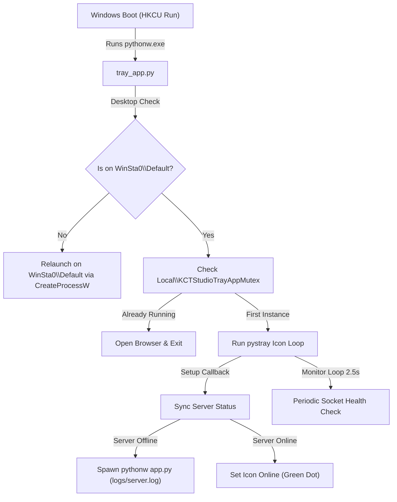

# System Tray & Boot Auto-Start

KCT Studio includes a dedicated Windows System Tray application (`tray_app.py`) that monitors the server health, manages process lifecycle, and allows auto-starting when Windows boots.

---

## 1. System Tray Architecture



---

## 2. Right-Click Context Menu

Right-clicking the KCT Studio tray icon opens the context menu:

```text
[ KCT Studio: ● Online (:7860)  ]  <- Live server status indicator
---------------------------------
[ 🌐 Open Dashboard             ]  <- Opens browser to https://127.0.0.1:7860 (Default double-click action)
---------------------------------
[ ▶ Start Server                ]  <- Starts FastAPI server in background (Active when offline)
[ ⏹ Stop Server                 ]  <- Gracefully stops server process and frees port 7860
[ 🔄 Restart Server             ]  <- Restarts server process cleanly
---------------------------------
[ ✓ Start with Windows Boot     ]  <- Interactive toggle for registry auto-boot
[ 📄 View Server Logs           ]  <- Opens logs/server.log in Windows Notepad
[ 📂 Open Project Directory     ]  <- Opens workspace in Windows Explorer
---------------------------------
[ ❌ Exit Tray & Server         ]  <- Shuts down server and removes icon from tray
```

---

## 3. Dynamic Tray Icon States

The tray icon is dynamically rendered using `PIL.ImageDraw`:
- **● Online** (Green dot `RGB(16, 185, 129)`): Server is up and listening on port 7860.
- **○ Offline** (Red dot `RGB(239, 68, 68)`): Server is stopped. Port 7860 is free.
- **⏳ Starting / Stopping** (Amber dot `RGB(245, 158, 11)`): Process is transitioning.

---

## 4. Key Windows Integrations

### Silent Execution Without Console Windows
- Launched using `pythonw.exe` rather than `python.exe`.
- Subprocesses use `subprocess.CREATE_NO_WINDOW` (`0x08000000`) so no black command prompt window ever flashes on screen.

### Desktop Session Awareness (`ensure_interactive_desktop`)
- Windows Explorer's System Tray (`Shell_TrayWnd`) lives exclusively on the user's interactive `WinSta0\Default` desktop.
- If launched from a non-interactive station (e.g. background automation), `tray_app.py` detects the desktop via Win32 `GetUserObjectInformationW` and automatically re-spawns itself onto `WinSta0\Default`.

### Boot Auto-Start Registration
- **Registry Key**: `HKCU\Software\Microsoft\Windows\CurrentVersion\Run\KCTStudioPipeline`
- **Command Value**: `"C:\Path\To\pythonw.exe" "C:\Projects\AI-Content-Generation-Pipeline\tray_app.py"`
- Toggleable directly from the tray context menu or via:
  ```powershell
  python tray_app.py --install-startup    # Enable
  python tray_app.py --uninstall-startup  # Disable
  ```

### Single-Instance & Replacement Handling
- Protected by `Local\KCTStudioTrayAppMutex`.
- When invoked with `--restart` (e.g. from `start_tray.bat`), any stale or orphaned `tray_app.py` instances are terminated via `psutil` before acquiring the mutex.
